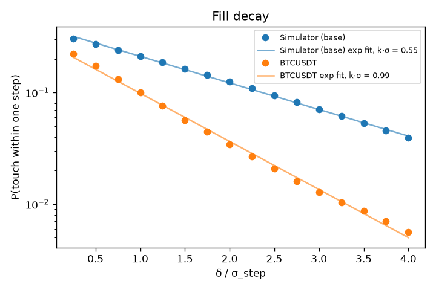

# Realism check: simulator vs BTCUSDT (2026-11-25)

Data: Binance spot BTCUSDT aggTrades, 2026-11-25 ([zip](https://data.binance.vision/data/spot/daily/aggTrades/BTCUSDT/BTCUSDT-aggTrades-2026-11-25.zip), sha256 `59fa83f7c425d7f54da49b3858beac42017c5ea584698ebdeef860285322bb38`). 1,729,771 aggTrades merged into 921,160 taker orders. Simulator: base scenario, dev seeds 0–29, 2000 steps each, raw taker intents (no agent, no book).

- Step = 1 s for BTCUSDT, one simulator step for the simulator. Distances and markouts are in σ_step (std of 1-step changes of the reference price), since BTC's tick is far finer than ours.
- Taker order: consecutive aggTrades with the same timestamp and side merged (summed size, last = worst price). Simulator: each intent, priced at its limit for fill decay and at the true value for markouts; within-step arrival times drawn uniformly for the inter-arrival CV.
- Reference price: BTCUSDT has no quote data here, so it is the last trade price (forward-filled per step); for the simulator it is the true value.
- A bid at ref − δ counts as touched if a selling taker trades at or below it within the step (ask symmetric). Trade-through is not a fill: real quotes have a queue ahead of them.
- Our quote would itself change taker behaviour; this only compares the flow we assume with the flow observed. Not a backtest, not a calibration.

## Fill decay (P that a quote δ away is traded through within one step)

| Statistic | Simulator (base) | BTCUSDT |
|---|---|---|
| P(touch) at δ = 0.5 σ | 0.271 | 0.173 |
| P(touch) at δ = 1 σ | 0.212 | 0.101 |
| P(touch) at δ = 2 σ | 0.125 | 0.0341 |
| P(touch) at δ = 4 σ | 0.0393 | 0.00559 |
| Exponential fit: k·σ | 0.549 | 0.993 |
| Exponential fit: R² | 0.999 | 0.997 |
| Power-law fit: exponent | 0.767 | 1.43 |
| Power-law fit: R² | 0.858 | 0.904 |

## Taker arrivals

| Statistic | Simulator (base) | BTCUSDT |
|---|---|---|
| Taker orders per step | 1.17 | 10.7 |
| Dispersion index (var/mean of counts) | 0.999 | 27.6 |
| Inter-arrival CV | 0.996 | 2.79 |

## Taker order sizes

| Statistic | Simulator (base) | BTCUSDT |
|---|---|---|
| p90 / median | 2 | 12.3 |
| p99 / median | 3.33 | 152 |
| max / median | 3.33 | 2.23e+04 |
| Excess kurtosis | 0.745 | 1.01e+04 |

## Taker markouts (σ_step; positive = price moved the taker's way)

| Statistic | Simulator (base) | BTCUSDT |
|---|---|---|
| Share of orders, size 0-50% | 0.508 | 0.638 |
| Share of orders, size 50-90% | 0.392 | 0.262 |
| Share of orders, size 90-99% | 0.0992 | 0.09 |
| Share of orders, size 99-100% | 0 | 0.01 |
| h = 1, size 0-50% | -0.00584 | 0.467 |
| h = 1, size 50-90% | 0.0322 | 0.698 |
| h = 1, size 90-99% | 0.277 | 0.839 |
| h = 1, size 99-100% | n/a | 0.748 |
| h = 10, size 0-50% | -0.0196 | 0.557 |
| h = 10, size 50-90% | 0.348 | 0.865 |
| h = 10, size 90-99% | 2.5 | 0.939 |
| h = 10, size 99-100% | n/a | 0.862 |
| h = 60, size 0-50% | -0.0634 | 0.461 |
| h = 60, size 50-90% | 0.407 | 0.888 |
| h = 60, size 90-99% | 2.73 | 0.831 |
| h = 60, size 99-100% | n/a | 0.281 |

## Price process

| Statistic | Simulator (base) | BTCUSDT |
|---|---|---|
| σ_step (sim: ticks, BTC: USDT) | 0.996 | 6.77 |
| Variance ratio, h = 10 | 1 | 1.29 |
| Variance ratio, h = 60 | 1.02 | 1.32 |
| Excess kurtosis of 1-step changes | -0.0123 | 16.9 |

## Robustness to the step width (BTCUSDT)

| BTCUSDT | step 0.1 s | step 1 s | step 10 s |
|---|---|---|---|
| Dispersion index | 9.6 | 27.6 | 148 |
| Variance ratio, h = 10 | 1.57 | 1.29 | 1 |
| Variance ratio, h = 60 | 1.97 | 1.32 | 0.942 |

**Interpretation:** TBD
